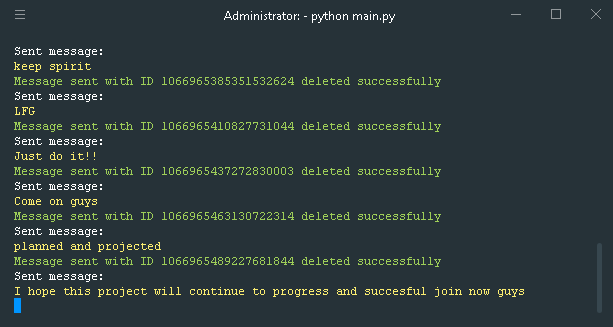

# Discord Bot: Type and Delete Messages

A small Python script that automatically posts messages to a Discord channel and deletes them again on a timer, using a Discord user token. It picks a random line from a message list, sends it, waits, deletes it, and repeats.



## About

Discord Bot: Type and Delete Messages runs as a self-bot on a Discord user account. You give it a channel, a list of messages, and two timers: how long each message stays visible before it is deleted, and how long to wait before sending the next one. It then loops on its own until you stop it.

## Features

- Sends a random message from `message.txt` (one message per line) to a chosen channel
- Deletes each sent message automatically after a delay you set
- Continuous loop with a configurable send interval
- Interactive terminal setup: channel ID, delete delay, and send interval are asked at startup
- Runs on a PC or on Android through Termux

## How It Works

1. The script reads your token from `token.txt` and the message list from `message.txt`
2. It asks for the channel ID (not the server ID), the delete delay, and the send interval
3. It posts a random message to the channel through the Discord API
4. After the delete delay, it fetches the channel's newest message and deletes it
5. After the send interval, it repeats from step 3

## Setup

Put your Discord user token in `token.txt` and your messages in `message.txt` (one per line), then run the script.

On a PC or laptop:

```bash
git clone https://github.com/xsrazy/Discord-Bot
cd Discord-Bot
pip install -r requirements.txt
python main.py
```

On Android with Termux:

```bash
pkg install git python openssl
git clone https://github.com/xsrazy/Discord-Bot
cd Discord-Bot
pip install requests colorama
python main.py
```

## How to Get a User Token

1. Open discord.com and choose "Open Discord in your browser"
2. Open the browser's Developer Tools (the three-dot menu, More Tools, Developer Tools)
3. Go to Application, then Storage, then Local Storage for discord.com
4. Search for "token" and copy the value into `token.txt`

## Notes

- This script uses a Discord **user token** (self-bot). Discord strictly forbids automation with user tokens, and the account can be banned if detected. Use a spare account, at your own risk
- Never share your `token.txt` once your real token is in it: anyone with that token controls the account

## License

MIT License. See [LICENSE](LICENSE) for details.

<a href="https://www.buymeacoffee.com/xsrazy" target="_blank"></a>
